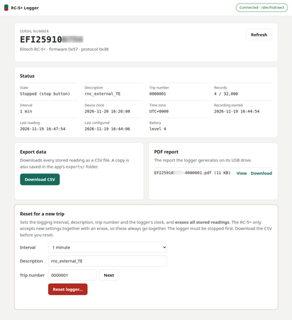

<!--
  File:    README.md
  Version: 1.8.2
  Project: rc5plus-app — Bun web app for the Elitech RC-5+ temperature logger
-->

# rc5plus-app

A Bun web app for the **Elitech RC-5+** USB temperature logger on Linux. No ElitechLog, Windows VM or Python needed, and no third-party libraries: just Bun.

- Detects a connected RC-5+ and shows its serial number and status
- Resets the logger for a new trip: sets the logging interval (1–15 minutes), the description and trip number printed on its reports, and the clock, and erases the stored readings. The RC-5+ only accepts new settings together with an erase, so these are one action.
- Lets you view and download the PDF report from the logger's USB drive
- Exports every reading to CSV

<a href="docs/images/rc5plus-app.png"></a>

*The app with an RC-5+ TE plugged in (serial number partly blurred). Click the image for full size.*

The HID protocol is a JavaScript port of [python-elitech](https://github.com/pasccom/python-elitech) by Pascal Combes, which was reverse-engineered from the official software and tested on an RC-5+. Because it is a derived work, this app is licensed **GPL-3.0-or-later**.

## Requirements

- Linux. The app uses `/dev/hidraw*` and `/sys`.
- Bun 1.2.3 or newer (only to run from source or build the binary)
- `udisks2` (`udisksctl`), which is standard on Kubuntu/KDE. It's only used to mount the PDF drive if the desktop hasn't already mounted it.

## Step-by-step installation (for beginners)

This guide assumes you've never used the Linux terminal much. It was written on **Kubuntu**; it works the same way on Ubuntu, Linux Mint and other Ubuntu or Debian-based systems. Other systems are noted where a command differs.

You'll need:
- the Linux PC the logger will be plugged into, connected to the internet
- your password for that PC (some steps install software and ask for it)
- the RC-5+ logger (only needed from step 7 onwards)

It takes about 10 minutes.

### 1. Open a terminal

The terminal is a window where you type commands.

- **Kubuntu:** press **Ctrl+Alt+T**, or open the application menu and search for **Konsole**.
- **Ubuntu / Mint:** press **Ctrl+Alt+T**, or search for **Terminal**.

Some tips before you start:
- Copy each command from this page and paste it into the terminal with **Ctrl+Shift+V** (plain Ctrl+V doesn't work in most terminals), then press **Enter**.
- Run one grey box at a time, and wait until the terminal is ready for more input before the next one.
- Text after a `#` is a comment for you to read. Pasting it is harmless.
- When a command starts with `sudo`, it asks for your password. **Nothing appears as you type it**, not even dots. This is normal: type it and press Enter.
- If a command asks `Do you want to continue? [Y/n]`, type `y` and press Enter.

### 2. Install the basic tools

These are the tools for downloading the app (`git`, `curl`, `unzip`) and for opening the logger's USB drive (`udisks2`, normally already there).

Ubuntu, Kubuntu, Mint or Debian:

```bash
sudo apt update
sudo apt install git curl unzip udisks2
```

On Fedora, use `sudo dnf install git curl unzip udisks2` instead.

### 3. Install Bun

[Bun](https://bun.sh) runs the app. It installs into a folder in your home directory (`~/.bun`), and doesn't need your password:

```bash
curl -fsSL https://bun.sh/install | bash
```

**Close the terminal window and open a new one** so it finds Bun, then check that it worked:

```bash
bun --version
```

This should print a version number, such as `1.4.4`. If it says `bun: command not found`, see [Troubleshooting](#troubleshooting).

### 4. Download the app

This puts the app in a folder called `rc5plus-app` in your home folder:

```bash
cd ~
git clone https://github.com/HamptonNorth/rc5plus.git rc5plus-app
cd rc5plus-app
```

The app needs nothing else: it uses only Bun's built-in features, so there are no extra libraries to download.

### 5. Let your user account use the logger

Linux doesn't let ordinary programs talk to USB devices like the logger by default. The file `60-elitech-rc5plus.rules`, which comes with the app, gives the user logged in at the desktop access to the RC-5+, and to no other device. Copy it into place and tell Linux to reload its rules:

```bash
cd ~/rc5plus-app
sudo cp 60-elitech-rc5plus.rules /etc/udev/rules.d/
sudo udevadm control --reload-rules
sudo udevadm trigger
```

You only do this once. If the logger is already plugged in, unplug it and plug it back in.

### 6. Try the app without a logger (optional)

The app has a built-in pretend logger, so you can look around without changing anything real:

```bash
cd ~/rc5plus-app
bun run mock
```

The terminal shows `RC-5+ app … on http://127.0.0.1:3005`. Open your web browser (Firefox, Chrome, etc.) and go to **http://127.0.0.1:3005**. You'll see a pretend logger called "Mock fridge".

To stop the app, click the terminal window and press **Ctrl+C**.

### 7. Run the app with your logger

1. Plug the logger into a USB port.
2. In the terminal, run:

   ```bash
   cd ~/rc5plus-app
   bun start
   ```

3. Open **http://127.0.0.1:3005** in your browser. After a couple of seconds the page shows the logger's serial number and status.

**Keep the terminal window open** while you use the app; closing it stops the app. When you've finished, press **Ctrl+C** in the terminal, or just close the window.

Before you reset a real logger, read [First run on a real logger](#first-run-on-a-real-logger). A reset **erases every reading** on the logger, so download the CSV and the PDF first.

Where your files go:
- **Download CSV** saves the file to your browser's Downloads folder, and keeps a copy in `~/rc5plus-app/exports/`.
- Before each reset, the app saves a backup of the logger's settings in `~/rc5plus-app/dumps/`. Keep these: they can undo a reset that goes wrong (see [Restoring settings](#restoring-settings)).

### 8. Add the app to your application menu (optional)

This turns the app into a single program file and adds a menu entry, so you can start it without typing commands. It also opens the browser for you.

First build the program and copy it to your personal programs folder, `~/.local/bin`:

```bash
cd ~/rc5plus-app
bun run build
mkdir -p ~/.local/bin
install -m 755 dist/rc5plus-app ~/.local/bin/
```

Then create the menu entry. Copy and paste this whole box in one go:

```bash
mkdir -p ~/.local/share/applications
cat > ~/.local/share/applications/rc5plus-app.desktop <<EOF
[Desktop Entry]
Type=Application
Name=RC-5+ Logger
Comment=Elitech RC-5+ temperature logger: status, reset, CSV and PDF
Exec=sh -c "(sleep 2; xdg-open http://127.0.0.1:3005) & exec $HOME/.local/bin/rc5plus-app"
Icon=utilities-system-monitor
Terminal=true
Categories=Utility;
EOF
```

**RC-5+ Logger** now appears in the application menu (on Kubuntu, under **Utilities**, or search for it). It opens a terminal window that runs the app, and then opens the app in your browser. Close that terminal window to stop the app.

The installed program saves its files in a different place from step 7: CSV copies go to `~/.local/share/rc5plus-app/exports/` and backups to `~/.local/share/rc5plus-app/dumps/`. To see these in the Dolphin file manager, press **Ctrl+H** to show hidden folders, or type `~/.local/share/rc5plus-app` in the address bar.

### Updating to a newer version

```bash
cd ~/rc5plus-app
git pull
```

If you did step 8, also rebuild the program and copy it again:

```bash
bun run build
install -m 755 dist/rc5plus-app ~/.local/bin/
```

### Uninstalling

```bash
rm -f ~/.local/bin/rc5plus-app ~/.local/share/applications/rc5plus-app.desktop
sudo rm -f /etc/udev/rules.d/60-elitech-rc5plus.rules
rm -rf ~/rc5plus-app
```

The last line also deletes the CSV copies and backups saved in `~/rc5plus-app`, so copy those somewhere else first if you want to keep them. The installed program's files are in `~/.local/share/rc5plus-app`; delete that folder too if you no longer need them. To remove Bun as well, run `rm -rf ~/.bun`.

### Troubleshooting

| What you see | What to do |
|---|---|
| `bun: command not found` | Close the terminal and open a new one. If that doesn't help, run `source ~/.bashrc`, or log out and back in. |
| `git: command not found` or `curl: command not found` | Step 2 was missed or failed. Run it again. |
| The browser says it **can't connect** to 127.0.0.1:3005 | The app isn't running. Start it again (step 7) and keep its terminal window open. |
| The page says **No logger connected** | Check the USB cable is pushed in fully and try another port. Some cables only carry power; use the one that came with the logger. |
| **Permission denied opening /dev/hidraw…** | The rule from step 5 isn't in use. Repeat step 5, then unplug and replug the logger. |
| `EADDRINUSE` or **address already in use** when starting | The app is already running in another window or from the menu. Use that one or close it. Or run a second copy on another port with `PORT=3006 bun start` and go to http://127.0.0.1:3006. |
| **Reset logger…** is greyed out | The logger is still recording. Unplug it, hold its stop button until the display shows "Stop", and plug it back in (see [First run on a real logger](#first-run-on-a-real-logger)). |
| No PDF is listed | The logger only makes the PDF after it has been stopped. Its USB drive may also need mounting: open the Dolphin file manager and click the logger's drive in the left panel, then refresh the page. |
| **Busy**: another program is using the logger | Only one program can talk to the logger at a time. Close the other one (for example `bun run dump`, or a second copy of the app) and try again. |

## Quick install (experienced users)

Run these on the Linux PC the logger plugs into:

```bash
git clone https://github.com/HamptonNorth/rc5plus.git rc5plus-app
cd rc5plus-app            # no dependencies, so no `bun install`

# Allow your desktop user to talk to the logger without sudo
sudo cp 60-elitech-rc5plus.rules /etc/udev/rules.d/
sudo udevadm control --reload-rules && sudo udevadm trigger
# Unplug and replug the logger
```

Check that the rule applied:

```bash
lsusb | grep 04d8:3005          # the RC-5+
ls -l /dev/hidraw*              # one node should show a "+" (ACL) for your user
```

## Run

```bash
bun start                 # http://127.0.0.1:3005
```

| Command | Purpose |
|---|---|
| `bun start` | Run against real hardware |
| `bun run dev` | Same, restarting on file changes |
| `bun run mock` | Run against a built-in simulated RC-5+ (no hardware needed) |
| `bun test` | Run the protocol and simulator tests |
| `bun run build` | Build the single-file executable (see below) |

Environment variables: `PORT` (default `3005`), `HOST` (default `127.0.0.1`), `RC5_MOCK=1` (simulator), `RC5_DATA_DIR` (where `exports/` and `dumps/` go).

The API controls hardware and has no authentication, so it binds to localhost only. Don't set `HOST=0.0.0.0` on an untrusted network.

## Compiled binary

`bun run build` makes a single executable, `dist/rc5plus-app`, that includes Bun itself and the web UI. The PC it runs on doesn't need Bun or the source; it still needs the udev rule and `udisks2`.

```bash
bun run build                     # dist/rc5plus-app (about 105 MB) for this PC's CPU
bun run build:arm64               # dist/rc5plus-app-arm64, e.g. for a Raspberry Pi
install -m 755 dist/rc5plus-app ~/.local/bin/

rc5plus-app                       # http://127.0.0.1:3005
rc5plus-app --version
RC5_MOCK=1 rc5plus-app            # simulated logger
```

It takes the same environment variables as `bun start`. Exports and dumps go to `~/.local/share/rc5plus-app/` (`exports/`, `dumps/`), not the repository. Set `RC5_DATA_DIR` to put them somewhere else; from source it defaults to the repository root as before. The `.map` file next to the binary is only for debugging and doesn't need to be copied.

`bun run dump` and `bun run restore` aren't in the binary; run them from the source tree. To restore from a backup the binary saved, give its full path, for example `bun run restore --template ~/.local/share/rc5plus-app/dumps/<file>.json`.

## First run on a real logger

The protocol port matches python-elitech byte for byte. It has been checked on one RC-5+ (firmware V5.7, protocol `0x38`); go through these checks in order the first time on another logger:

**Stop the logger first.** The app only changes settings on a logger that has been stopped with its own stop button: unplug it, press and hold stop until the display shows "Stop", then plug it back in. While plugged in the display always shows "USB", so check the **State** row in the app instead. While the logger is recording, **Reset logger…** is disabled and the API answers `409 NOT_STOPPED`. Reading, CSV export and PDFs work in any state.

1. **Read only.** Plug in the logger and open the page. Check that the serial number matches the label on the logger, and that the record count and interval match what ElitechLog or the PDF shows.
2. **Export.** Click **Download CSV**. Compare a few rows with the PDF.
3. **Reset**, only after steps 1–2 look right and you've exported anything you need. Pick the interval, check the description and trip number (both start as the logger's current values; **Next** adds 1 to the trip number), and click **Reset logger…**. The app checks the logger is stopped and that its settings look valid, and saves a full backup to `dumps/<serial>-<time>-before-reset.json`. It then writes back the logger's whole settings memory with the new interval and the current time, and sends *Format*, which commits them, erases the readings and sets the clock. Finally it checks every settings byte, 0 records and the clock. The **State** row should then read "Ready, not started".

If anything misbehaves, the app reports the logger's error. ElitechLog in a Windows VM can still reset the logger.

## How it works

```
Browser ──HTTP──▶ Bun.serve routes (src/app.js, started by src/server.js)
                    │
                    ├─ LoggerService ── one HID session at a time
                    │     └─ Rc5Plus ── readInfo / resetForNewTrip / readRecords
                    │           └─ HidrawTransport ── /dev/hidrawN, 64-byte reports, non-blocking
                    │
                    └─ usb-drive.js ── sysfs → /dev/sdX → mount point → *.pdf
```

- **Detection** scans `/sys/class/hidraw` for VID `04d8` / PID `3005`, with no USB traffic. The page polls it every 2.5 s.
- **Frames**: `33 CC 00 <len> <op lo> <op hi> 00 <off 15..8> <off 7..0> <off 23..16> <count> <payload…> <sum & 0xFF>`, zero-padded to 64 bytes.
- **Records**: 8-byte little-endian packed words (time, temperature in tenths, flags), 6 per request.
- **Run state** is bits 0..5 of byte `0x25`: `0x04` ready (reset, not started), `0x05` start delay, `0x07` recording, `0x09` stopped. A reset is allowed only when stopped or ready; anything else is refused.
- **Settings** are committed by Format. The logger acknowledges a parameter write but keeps the old value until a Format follows, and Format erases the readings. Some loggers (an RC-5+ TE here) store only what was written since the last Format and erase the rest, so reset writes every settings block, like the official software, then Formats and reads everything back.
- **Trip times** ("Recording started", "Last reading") come from the logger's second "shadow" memory space (read with operation `0x05`), because the RC-5+ never fills in the start/stop times in its main settings memory. This layout was worked out from one logger and is still being confirmed; if the shadow read fails, the rest of the info still loads.
- **Times** are the logger's local wall-clock time. Clear writes this PC's local time.

## API

| Method | Path | Body / query | Result |
|---|---|---|---|
| GET | `/api/status` | | `{ connected, devPath, mock }` |
| GET | `/api/info` | | Serial number, settings, record count, clock |
| POST | `/api/reset` | `{ "minutes": 1..15, "confirm": true, "description"?: "…", "tripNumber"?: "…" }` (omit a text field to keep it) | Info after reset (0 records), `409 NOT_STOPPED`, `409 SETTINGS_ERASED` or `502 NOT_APPLIED` |

Any request that talks to the logger answers `423 BUSY` if another program (such as `bun run dump`) holds the device lock for more than 20 s.
| GET | `/api/export.csv` | | CSV download (copy saved in `exports/`) |
| GET | `/api/pdfs` | | PDFs on the logger's drive |
| GET | `/api/pdfs/:name` | `?download=1` | The PDF, inline or as an attachment |

## Diagnostic dump

`bun run dump` prints a read-only snapshot of the connected logger: USB details, the files on its drive, a hex dump of its settings memory (`0x000`–`0x154`) with every known field decoded, and the unmapped bytes that hold data. Run it on the PC the logger is plugged into.

| Command | Does |
|---|---|
| `bun run dump` | Snapshot to the terminal |
| `bun run dump --save` | Also writes `dumps/<serial>-<time>.json` |
| `bun run dump --shadow` | Also reads the second "shadow" memory space (operation `0x05`), which holds the real trip start/stop times and record count |
| `bun run dump --records[=N]` | Also reads records with their raw bytes: all, or the first and last N |
| `bun run dump --redact` | Blanks the serial number, description, PDF password and device name, for sharing (e.g. in an upstream issue) |
| `bun run dump --watch[=SECONDS]` | Re-reads every few seconds (default 3) and prints only the bytes that change, labelled with field names. Handles unplug/replug |
| `bun run dump --diff A.json B.json` | Compares two saved dumps byte by byte |
| `bun run dump --device /dev/hidrawN` | Picks a logger when several are plugged in |
| `bun run dump --show-password` | Shows the PDF password, which is masked by default |

The dump **never writes to the logger**: it can only send read requests, and anything else is refused before it reaches the device. It doesn't mount the drive either. It shares a lock with the app, so the two never talk to the logger at the same time; if the app is busy, the dump waits.

Saved dumps are only readable by you and are kept out of git (`dumps/`). They contain the serial number and description, and the PDF password if one is set, so use `--redact` before sharing one.


## Restoring settings

`bun run restore` rebuilds a logger's settings from a saved dump: one taken with `bun run dump --save`, or a `-before-reset` backup. Use it for a logger whose settings were erased (the app then shows "settings look blank or damaged" and won't reset it), or to undo a reset.

| Command | What it does |
|---|---|
| `bun run restore --template dumps/A.json` | Dry run: reads the logger, saves a `-before-restore` backup, and lists every byte that would change. Writes nothing |
| `bun run restore --template dumps/A.json --against dumps/B.json` | The same preview against a saved dump, with no logger attached |
| `… --write` | Writes the settings, sends Format (**erases every reading**) and checks every byte |
| `… --interval MIN` / `--description TEXT` | Change these on the way |
| `… --keep LIST` | Bytes kept from the logger rather than the template (default `0x1e,0xfd-0x10c`, which differ between models; `none` keeps nothing extra). The model, serial number, state bytes, capacity and record counts are always kept |
| `… --set 0x21=0x02` | Force one byte (repeatable) |

The template must be from the same model. Only the fields the app itself uses are confirmed on hardware; the rest are python-elitech's names, so check the dry run before `--write`, and check the readings of the first trip afterwards.

## CSV format

```
index,timestamp,temperature_c,marked,event
1,2026-11-17 15:54:00,4.0,no,
```

`marked` is a reading tagged by double-clicking the logger's right key. `event` is `pause`, `stop` or `sensor error` when the logger flagged one. The column is `temperature_f` if the logger is set to Fahrenheit.

## Tests

`test/vectors.json` is generated from python-elitech itself, so the JavaScript port is checked against the reference implementation:

```bash
git clone https://github.com/pasccom/python-elitech ../python-elitech
bun run vectors
bun test

# Includes tests for the dump's read-only guard, redaction, diff and the device lock.
```

## Acknowledgements

This app is based on [python-elitech](https://github.com/pasccom/python-elitech) by **Pascal Combes**. He worked out the Elitech logger protocol by reverse engineering the official Windows software with Ghidra. That covers the HID frame format, the operation codes, the parameter memory map and the packed record format. This app's protocol code (`src/elitech/frame.js`, `parameters.js`, `records.js`, `rc5plus.js`) is a JavaScript port of his Python code, and its tests are checked against vectors generated from his library. None of this app would exist without his investigations.

Thanks also to the contributors to python-elitech's issues and pull requests, especially **honx** (PRs #12–#14). Those PRs document the official software's full settings write and reset sequence, the "shadow" memory space and the run-state values. They are what made the RC-5+ and RC-5+ TE reset in this app work.

What this app adds was found on real RC-5+ and RC-5+ TE loggers (firmware `0x57`, protocol `0x38`). It is written up in [`docs/FINDINGS.md`](docs/FINDINGS.md). The main points:
- settings only stick after a Format, and the whole settings block must be written first
- where the real trip times live in shadow memory
- the live temperature reading at `0x86`

## Licensing information

*rc5plus-app* is free software: you can redistribute it and/or modify
it under the terms of the GNU General Public License as published by
the Free Software Foundation, either version 3 of the License, or
(at your option) any later version.

*rc5plus-app* is distributed in the hope that it will be useful,
but WITHOUT ANY WARRANTY; without even the implied warranty of
MERCHANTABILITY or FITNESS FOR A PARTICULAR PURPOSE. See the
GNU General Public License for more details.

You should have received a copy of the GNU General Public License
along with *rc5plus-app*. If not, see <https://www.gnu.org/licenses/>.

*rc5plus-app* is a derived work of *python-elitech*, Copyright © 2023 Pascal Combes,
which is licensed under the same terms (GPL-3.0-or-later). The full licence text is in `LICENSE`.
